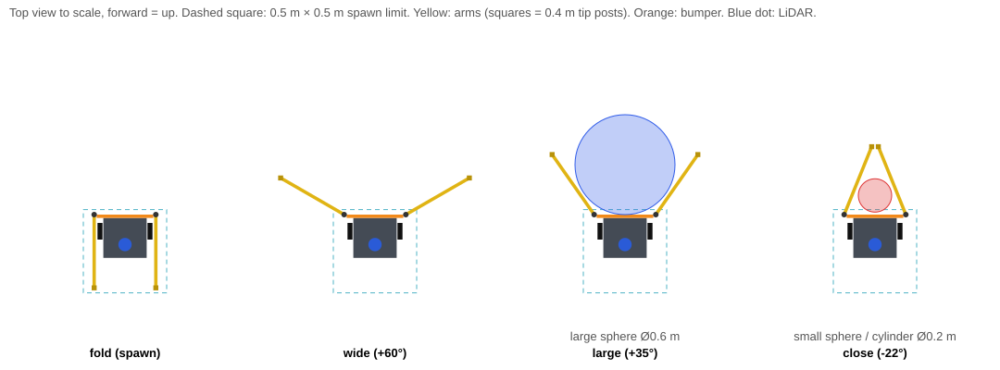
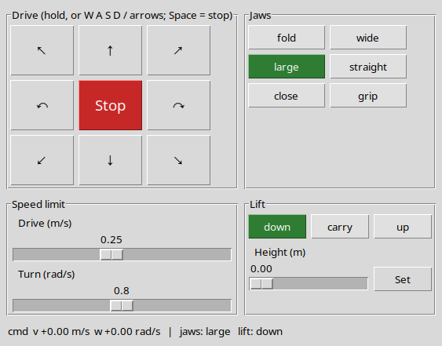
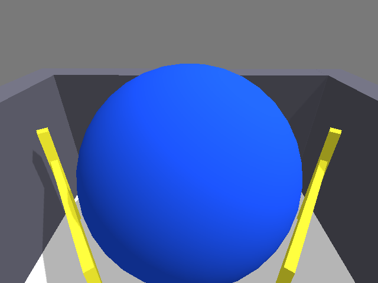
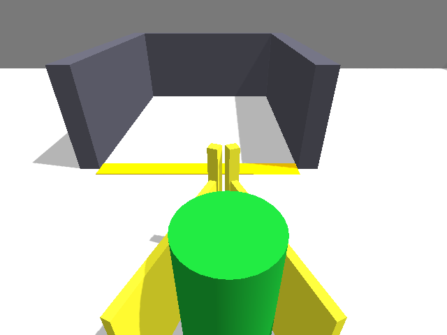

# PDE4430 Bay Robot

Coursework for **PDE4430 Mobile Robotics** (Middlesex University Dubai, 2026–27).

A differential-drive robot with a low front bumper and a **fold-out gripper on a lift**: two motorised jaws with rubber grip pads, which push, cage or **pick up** objects. It delivers the large sphere, the small sphere and the upright cylinder of the [`assessment_bay`](https://github.com/sameerkishore/ros2_assessment_world) world through the bay opening, using **physical contact only**. No joints, plugins or services attach objects or set their pose.

> Status: robot design, gripper and lift, Gazebo integration, gripper control, scripted delivery trials and the teleoperation GUI done. Autonomy is in progress.

---

## 1. The task, in numbers

From the `assessment_bay` package:

| Thing | Size | Consequence for the design |
|---|---|---|
| Spawn footprint | ≤ 0.5 × 0.5 m | Anything wider must fold out after spawning |
| Large sphere | Ø 0.60 m, 1.0 kg, μ 0.8 | Wider than the robot. A plain V cannot hold it, and it rolls off sideways when turning |
| Small sphere | Ø 0.20 m, 0.3 kg | Rolls freely and keeps rolling after a push |
| Cylinder | Ø 0.20 × 0.40 m, CoM 0.20 m, μ 0.5 | Slides if pushed low, **tips if pushed above ~0.20 m** |
| Bay opening | 1.0 m wide, faces south at y = 1.6 m | The large sphere must be lined up to within ±0.2 m |
| Start pad | (0, −2.6), facing +y | Spawn pose |

## 2. Approach and robot design



| Part | Choice | Why |
|---|---|---|
| Base | Differential drive, 0.24 × 0.26 m chassis, wheels r 0.05 m on a 0.30 m track. Front and rear ball casters | Turns on the spot for small, precise corrections. Two casters stop it pitching when the arms are out |
| Bumper | Plate 0.34 m wide, **0.02–0.24 m** above the floor | Pushes the cylinder with its contact centroid at ~0.13 m, below its 0.20 m CoM, so it slides instead of tipping. Meets the large sphere just under its equator |
| **Gripper jaws** | Two 0.44 m plates, 0.02–0.30 m high, pivoting about vertical axes at the bumper corners, with a 0.40 m post at each tip. Driven by Gazebo joint position controllers (effort limit 5 N·m, about 25 N squeeze at the pads) | Folded back along the sides at spawn (0.451 × 0.475 m footprint). Swing out after spawn to guide, cage or grip each object (modes below) |
| **Grip pads** | Black rubber pads (μ 1.5), 0.12 × 0.15 m, 0.05–0.20 m above the floor, mounted **turned 27°** on the jaws, plus a rubber pad on the bumper face | When the jaws close on a 0.2 m object (they stop at about 27° inward), the two pad faces are **parallel** and press straight across its middle, like a parallel-jaw gripper, so a sphere cannot roll out. Separate links on preserved fixed joints, so they grip while the rest of each jaw stays slippery for guiding |
| **Lift** | Carriage on two steel rails, prismatic joint 0–0.15 m, PID force control | Raises both jaws, so a gripped small sphere or cylinder is **picked up** and carried clear of the floor, then set down in the bay |
| Friction | Wheels μ 1.0, casters 0, bumper 0.3, jaws 0.1, pads 1.5 | Objects slide along the jaws into the centre, and the pads hold them when squeezed |
| LiDAR | 360°, 0.12–8 m, on a mast, scan plane **0.35 m** | Above the arms and bumper so they don't block it. Below the 0.5 m bay walls, and sees the 0.4 m cylinder and the large sphere |
| Camera | 640×480, on a pole at **0.72 m**, tilted 31° down | Sees the jaws and, over the top of the 0.6 m sphere, the yellow strip and objects ahead |
| Motion limits | 0.5 m/s, 0.5 m/s², 1.5 rad/s | Gentle acceleration so pushed spheres aren't flung ahead |

Total mass 7.0 kg. Inertias use the solid-body formulas (comments in the URDF).

### Arm modes

Angles are measured outward from straight ahead. They come from the object sizes (see `scripts/check_urdf.py` and the design notes in the URDF):

| Mode | Joint (rad) | Arm angle | Use |
|---|---|---|---|
| `fold` | 0.000 | folded back | Spawn pose, fits 0.5 × 0.5 m |
| `wide` | 2.094 | 60° out | Funnel for catching any object. Deployed automatically after spawn |
| `large` | 2.531 | 35° out | **V cradle** for the 0.6 m sphere (~1 cm play). Two long arm faces push it from behind its widest point, which keeps it centred while it is pushed straight |
| `straight` | 3.142 | 0° | Arms parallel. Releasing a small object inside the bay without hitting the bay walls |
| `close` | 3.526 | 22° in | Arms meet in front (2 cm gap): a cage for the 0.2 m sphere or cylinder (room for r = 0.117 m) |
| `grip` | 3.840 | 40° in (target) | The pads meet a 0.2 m object at about 27°. The target is deliberately past that, so the motors stay at their 5 N·m limit and the squeeze is the same for every object |

Lift heights (`/lift_mode`): `down` 0 m, `carry` 0.08 m, `up` 0.15 m, or any height in metres.

**Safety rules in `arm_controller`:** the jaws can only open (any mode except `grip`/`close`) while the lift is down, so a lifted object is never dropped by accident. `fold` while lifted lowers the lift first. All targets are clamped to the joint limits.

### Delivery strategy

- **Large sphere:** set `large` (V). First drive round to the far side of the sphere so that the robot, the sphere and the target are in a line. Then drive slowly into it so it settles in the V, and push **straight** without stopping. For the bay, line up with the opening and push until the robot is about 0.7 m short of the yellow strip (the V is 0.9 m wide, nearly as wide as the 1.0 m opening). Then stop: the sphere keeps rolling straight into the bay and stops at the back wall. If it drifts, back off and line up again rather than turning while pushing.
- **Small sphere / cylinder (pick and place):** open `wide` and drive up slowly. **Stop before the bumper touches the object**: a sphere that is bumped rolls away at the robot's speed. Then:
  1. `close`: the jaws swing in around it and centre it.
  2. `grip`: the pads squeeze it.
  3. Lift `carry`: it is picked up off the floor.
  4. Drive into the bay (turns are fine, it is held).
  5. Lift `down`, then `straight` to release, and reverse out.
- **Why not pick up the large sphere?** It is 0.6 m wide, wider than the robot. Jaws that fold inside the 0.5 m spawn square cannot reach around it, so it is pushed in the V.

*Design history (from the trials in section 7):*
1. **Catching from `wide`, then closing to 35°** squeezed the sphere forward out of the V, because the arms touch it behind its widest point. Fix: put the arms at 35° *before* reaching the sphere and drive into it.
2. **Turning while pushing** loses the large sphere whatever the arm shape. It rolls with almost no resistance, so any sideways push gives it speed it never loses, and a pusher cannot pull it back. Holding it through turns would need arms that wrap past its middle, which cannot fold inside the 0.5 m spawn square because the sphere is wider than the robot. **Line up and push straight** (the world's README also says the approach "has to be lined up").
3. **A narrow fork** (arms at 10°, sphere in the notch between the tips) was tried and dropped. In camera snapshots the sphere bounced between the two thin tips and slid off. The V pushes along two long faces and stays centred.
4. **Tip posts:** each arm got a 0.40 m post at its tip, so a sphere that rides along an arm meets a flat face rather than the plate's 0.30 m top edge (exactly its equator).

## 3. Package layout

```
pde4430_bay_robot/
├── urdf/bay_robot.urdf              robot model, Gazebo plugins and sensors
├── launch/sim.launch.py             assessment_bay world + robot + bridge + arm controller
├── launch/display.launch.py         view the model in RViz (sliders for the arms)
├── pde4430_bay_robot/arm_controller.py   gripper: jaw modes + lift heights -> joint targets
├── pde4430_bay_robot/teleop_gui.py       teleoperation window: drive, speed limit, jaws, lift
├── scripts/check_urdf.py            offline URDF checks (tree, inertia, footprint)
├── scripts/bay_trials.py            scripted delivery trials (testing only)
├── scripts/docker_sim_test.sh       full end-to-end test in Docker
├── scripts/urdf_preview.html        browser 3D viewer for the URDF
└── docker/                          browser-based ROS 2 + Gazebo desktop
```

## 4. Requirements

- Ubuntu 24.04, **ROS 2 Jazzy**, **Gazebo Harmonic**
- `ros-jazzy-ros-gz`, `ros-jazzy-joint-state-publisher-gui`, `ros-jazzy-teleop-twist-keyboard`
- The [`assessment_bay`](https://github.com/sameerkishore/ros2_assessment_world) package in the same workspace

## 5. Build and run

```bash
mkdir -p ~/pde4430_ws/src && cd ~/pde4430_ws/src
git clone https://github.com/sameerkishore/ros2_assessment_world.git
git clone <this-repo-url> pde4430_bay_robot
cd ~/pde4430_ws && colcon build --symlink-install
source install/setup.bash
```

**World + robot on the start pad** (the arms open to `wide` about 3 s after spawning):
```bash
ros2 launch pde4430_bay_robot sim.launch.py
ros2 launch pde4430_bay_robot sim.launch.py layout:=random seed:=42   # other object layouts
ros2 launch pde4430_bay_robot sim.launch.py render_engine:=ogre2 rviz:=true
```

**Teleoperation GUI** (second terminal):
```bash
ros2 run pde4430_bay_robot teleop_gui
```



- **Drive:** hold a direction button, or hold W/A/S/D or the arrow keys (two keys together for a curve). Releasing stops the robot; Space or **Stop** stops it at once. The robot also stops if the window loses focus.
- **Speed limit:** sliders for drive speed (up to 0.5 m/s) and turn rate (up to 1.5 rad/s), the robot's own limits.
- **Jaws / Lift:** one button per mode, plus a height slider for the lift. The highlighted button is the state `arm_controller` reports, so a refused request (e.g. opening the jaws while lifted) shows up straight away.

The keyboard teleop also still works: `ros2 run teleop_twist_keyboard teleop_twist_keyboard`.

**Arms from the command line** (third terminal):
```bash
ros2 topic pub --once /arm_mode std_msgs/msg/String "{data: grip}"    # fold|wide|large|straight|close|grip
ros2 topic pub --once /lift_mode std_msgs/msg/String "{data: carry}"  # down|carry|up or metres
```

**Reset objects / check results** (from `assessment_bay`; the checker is for testing only):
```bash
ros2 launch assessment_bay spawn_objects.launch.py
ros2 launch assessment_bay bay_checker.launch.py
```

## 6. Architecture (nodes, topics, messages)

```
                 /arm_mode, /lift_mode
teleop_gui  ------------------------------->  arm_controller
    |       <-------------------------------       |
    |           /arm_state, /lift_state            |  /left_arm/cmd_pos, /right_arm/cmd_pos,
    | /cmd_vel                                     |  /lift/cmd_pos
    v                                              v
ros_gz_bridge  <=========================================>  Gazebo (assessment_bay + bay_robot)
    |
    |  /odom /tf /joint_states /scan /camera/image_raw /clock
    v
robot_state_publisher -> /tf (robot links), RViz
```

| Topic | Type | Direction | Purpose |
|---|---|---|---|
| `/cmd_vel` | `geometry_msgs/Twist` | ROS → Gazebo | drive commands to the diff-drive plugin |
| `/arm_mode` | `std_msgs/String` | `teleop_gui` / user → `arm_controller` | jaw mode: `fold`, `wide`, `large`, `straight`, `close`, `grip` |
| `/lift_mode` | `std_msgs/String` | `teleop_gui` / user → `arm_controller` | lift: `down`, `carry`, `up` or a height in metres |
| `/arm_state`, `/lift_state` | `std_msgs/String` (latched) | `arm_controller` → `teleop_gui` | current jaw mode / lift setting |
| `/lift/cmd_pos` | `std_msgs/Float64` | ROS → Gazebo | lift height target (m) |
| `/left_arm/cmd_pos`, `/right_arm/cmd_pos` | `std_msgs/Float64` | ROS → Gazebo | arm joint targets (rad) |
| `/odom` | `nav_msgs/Odometry` | Gazebo → ROS | wheel odometry |
| `/tf` | `tf2_msgs/TFMessage` | Gazebo → ROS | `odom → base_footprint` |
| `/joint_states` | `sensor_msgs/JointState` | Gazebo → ROS | wheel and arm angles |
| `/scan` | `sensor_msgs/LaserScan` | Gazebo → ROS | LiDAR |
| `/camera/image_raw` | `sensor_msgs/Image` | Gazebo → ROS | camera |
| `/clock` | `rosgraph_msgs/Clock` | Gazebo → ROS | simulation time |

**Own nodes:**

`teleop_gui` is the operator window (tkinter). It publishes `/cmd_vel` at 10 Hz while a drive button or key is held, scaled by the speed sliders, then sends a few zero commands and goes quiet, so it does not fight other nodes driving the robot. Jaw and lift buttons send requests on `/arm_mode` and `/lift_mode`; the window shows the state `arm_controller` reports back.

`arm_controller` is the gripper controller. It maps jaw-mode names and lift heights to joint targets. It checks names against fixed lists, clamps targets to the joint limits, and refuses to open the jaws while an object is lifted. It re-sends targets at 5 Hz so none is lost while the bridge starts, and deploys the jaws automatically after spawning.

**Third-party nodes, and why:**
- `robot_state_publisher` publishes the robot's link transforms from the URDF and `/joint_states`, which RViz and later navigation need.
- `ros_gz_sim create` is the standard way to spawn a URDF into Gazebo Harmonic.
- `ros_gz_bridge parameter_bridge` converts the Gazebo transport topics above to and from ROS 2 messages.
- `teleop_twist_keyboard` gives simple keyboard driving on `/cmd_vel` (an alternative to `teleop_gui`).
- The Gazebo plugins `DiffDrive`, `JointPositionController` (jaws and lift in PID force mode) and `JointStatePublisher` turn velocity commands into wheel motion and drive the gripper.

*(The rqt_graph will be added here.)*

## 7. Testing

**Offline URDF check** (any OS with Python and numpy):
```bash
python scripts/check_urdf.py
```

**End-to-end test in Docker**: builds the workspace, checks the URDF, launches the assessment world and robot, checks spawn pose, arm deployment and sensors, then runs **delivery trials** for all three objects:
```bash
docker run --rm --network none --shm-size=2g -v <path-to>/pde4430_ws:/ws --entrypoint bash bay_desktop \
  /ws/src/pde4430_bay_robot/scripts/docker_sim_test.sh
```

Each trial (`scripts/bay_trials.py`) places the object 0.9 m ahead of the robot and catches it with the arms. It drives an S-bend (about 29° right, then 29° left) and checks the object is still in the jaws. It then delivers the object and judges the result with `assessment_bay`'s own `object_in_bay()` rule.

Latest full run with the gripper, after the switch to force-controlled jaws (tuning step 6; native Ubuntu, headless; **3/3 objects delivered**):

| Object | Method | Lift / object raised | Held while carried | Final position | Result |
|---|---|---|---|---|---|
| Large sphere | pushed in the 35° V, released 0.7 m short | (too big to grip) | centred | (0.00, 2.50) | in the bay |
| Small sphere | **gripped and lifted**, S-bend, set down | 7.9 cm / **7.7 cm** | held up through the S-bend | (−0.01, 2.69) | in the bay |
| Cylinder | **gripped and lifted**, S-bend, set down | 7.9 cm / **7.9 cm** | held up and upright | (0.14, 1.94) | in the bay, upright |

*Gripper tuning found by the trials:*
1. **Squeeze force:** a jaw target only 1° past the contact angle gave almost no squeeze, and the small sphere slipped. The `grip` target is now well past contact (40°), so the jaw motors always push at their effort limit.
2. **Effort limit:** at 12 N·m the cylinder was wedged so hard between the pads and the bumper that the physics solver locked the robot in place. 5 N·m (about 5× what the 0.5 kg cylinder needs) grips without jamming.
3. **Pad angle:** flat pads on the angled jaws pressed a sphere slightly ahead of its centre, so it rolled backwards out of the grip (it rose only 2–5 cm of the 8 cm lift). Turning the pads 27° makes them parallel when gripping: 0.2 cm slip.
4. **Lift control:** a velocity-mode controller could not move the lift under the jaws' weight. A PID force controller, capped at about 3× the lifted weight, rises smoothly and holds height.
5. **Deploy timing:** the jaws now deploy only after the robot's joints appear on `/joint_states`, and targets are re-sent on a steady clock. A command sent before the robot had spawned was lost.
6. **Jaw control:** after a Gazebo Harmonic update (gz-sim vendor package, Nov 2026) the velocity-mode jaw controllers still received their targets but the jaws no longer moved, so they stayed folded after spawning. The jaws now use the same PID force mode as the lift: p 20, d 2, torque capped at 5 N·m (the joint effort limit). In `grip` the target is about 13° past contact, so the controller asks for about 4.6 N·m and the squeeze is nearly the same as before. All three trials pass again with the same lift heights.

Robot camera views during the trials (from `bay_trials.py`, `SNAPSHOTS=<dir>`):

| Large sphere in the V | Cylinder caged |
|---|---|
|  |  |

> The trials use Gazebo ground truth **only to set up and judge** each test, as the brief allows. The robot's own nodes never use object positions.

## 8. Running without Ubuntu (browser desktop in Docker)

`docker/` builds a ROS 2 Jazzy + Gazebo Harmonic desktop that runs in Docker and opens in a web browser through noVNC. It works on Windows or macOS with Docker Desktop.

```bash
docker build -t bay_desktop docker/
docker run -d --name bay_desktop -p 127.0.0.1:6080:6080 --shm-size=2g \
  -v <path-to>/pde4430_ws:/ws bay_desktop
```
Then open `http://localhost:6080/vnc.html?autoconnect=true&resize=remote`. The container builds the workspace (both packages) on start. Its terminals have these shortcuts:

| Command | Does |
|---|---|
| `sim` | assessment_bay world + robot on the start pad |
| `teleop` | keyboard driving |
| `arms <mode>` | `fold`, `wide`, `large`, `straight`, `close`, `grip` |
| `lift <height>` | `down`, `carry`, `up` or metres |
| `reset_objects` | put the three objects back |
| `baycheck` | ground-truth bay checker (testing only) |
| `model` | RViz model viewer |
| `rebuild` | rebuild after editing files on the host |

The container has no GPU, so rendering is software-only (Mesa) and much slower than native Ubuntu. Native Ubuntu is the target for the final demo. The VNC port is bound to `127.0.0.1` only.
